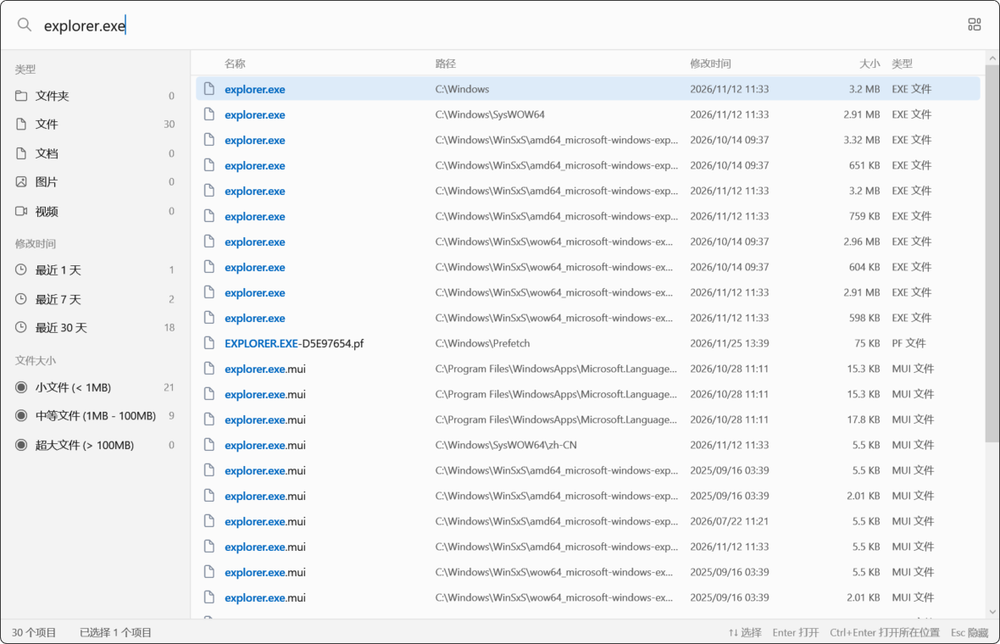
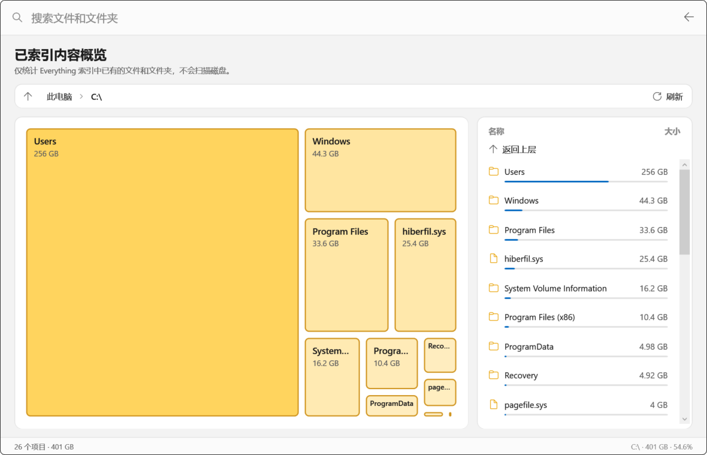

# Comb

Windows 上的轻量文件搜索器：双击 Ctrl 呼出浮动搜索条，边输边搜；另有「已索引内容概览」，用矩形树图看各个文件夹占了多大空间。

搜索引擎用本机的 [Everything](https://www.voidtools.com/) 1.4，通过它的 IPC 接口查询。不装服务、不需要管理员权限、运行时不写任何文件。

> Comb 是独立的个人项目，与 voidtools / Everything 没有关联。

双击 Ctrl 呼出的搜索条：


边输边搜，左侧筛选和计数联动，列头可排序：



已索引内容概览，方块越大越深，单击选中、双击进入：



## 功能

- 托盘常驻，双击 Ctrl 呼出 / 隐藏浮动搜索条
- 边输边搜：名称高亮，虚拟滚动，结果再多也只按需取数据
- 左侧筛选，各项计数随其他筛选联动：
  - 类型：文件夹、文件、文档、图片、视频
  - 修改时间：最近 1 天、7 天、30 天
  - 文件大小：小于 1 MB、1–100 MB、大于 100 MB（可多选，再点取消）
- 列头排序：名称、路径、修改时间、大小、类型。点一次升序，再点降序，第三次恢复默认
- 右键菜单：打开、以管理员身份打开、打开所在文件夹、复制名称、复制完整路径、剪切、复制、删除，下方附带 Windows 原生右键菜单
- 已索引内容概览：矩形树图 + 列表 + 面包屑逐层钻取。单击选中，双击进入文件夹或打开文件；没有默认打开方式的文件会打开所在文件夹并选中它
- Everything 没在运行时自动把它拉起来
- 托盘菜单里可以开关开机自启

## 运行要求

- Windows 10 / 11（需要 .NET Framework 4.8，Windows 10 1903 及以后的版本自带）
- [Everything](https://www.voidtools.com/) 1.4，装在默认位置（`Program Files\Everything\`）。Comb 找不到 Everything 窗口时会从这里启动它
- 概览要显示文件夹大小：在 Everything 里打开「工具 → 选项 → 索引 → 索引文件夹大小」。没打开时概览会给出提示
- 按「类型」排序嫌慢的话，可以在 Everything 同一页打开「快速扩展名排序」

## 使用

| 操作 | 效果 |
|---|---|
| 双击 Ctrl | 呼出 / 隐藏搜索条 |
| 输入文字 | 边输边搜，第一页结果回来后展开成结果窗口 |
| ↑ / ↓、PageUp / PageDown | 移动选中项 |
| Enter | 打开选中项 |
| Ctrl+Enter | 打开所在文件夹并选中它 |
| 双击结果 | 打开 |
| Esc | 隐藏窗口 |
| 搜索框右侧按钮 | 切换到内容概览 / 返回搜索 |
| 概览中按 Backspace（搜索框为空时） | 返回上一层 |

托盘图标：左键单击呼出搜索条；右键菜单有「显示搜索」「内容概览」「开机自启」「退出」。

双击 Ctrl 安装失败时，程序会在托盘提示快捷键暂不可用，并进行有限次数的自动重试；点击托盘仍可正常打开搜索。右键菜单提供热键状态和「重新启用双 Ctrl」，可以手动重试。若睡眠唤醒监听没有建立，托盘会单独说明这个限制。

窗口从隐藏状态呼出时，出现在鼠标所在屏幕；已经显示的窗口拖到另一块屏幕后，切换搜索条、结果和概览会采用窗口当前所在屏幕的工作区。

命令行参数：

- `Comb.exe`：启动。已在运行时再执行一次，等于呼出搜索条
- `Comb.exe --overview`：打开内容概览
- `Comb.exe --background`：静默启动，不显示窗口（开机自启用的就是它）

## 隐私与系统改动

- 不联网
- 运行时不写任何文件：没有配置、日志或缓存文件
- 唯一的持久化：打开开机自启时，在 `HKCU\Software\Microsoft\Windows\CurrentVersion\Run` 写一个名为 `Comb` 的值；关闭时删除
- 不修改 Everything 的任何配置

## 从源码构建

需要：

- Visual Studio 2022 Build Tools（提供 Roslyn 编译器 `csc.exe`）
- .NET Framework 4.8 的引用程序集（Build Tools 里的 .NET Framework 4.8 targeting pack）

在仓库根目录执行：

```powershell
powershell -NoProfile -ExecutionPolicy Bypass -File .\build.ps1
```

`build.ps1` 用 vswhere 自动查找最新一套 Visual Studio / Build Tools 里的 Roslyn `csc.exe`。找不到时可以手动指定：

```powershell
powershell -NoProfile -ExecutionPolicy Bypass -File .\build.ps1 -Csc "<csc.exe 的完整路径>"
```

输出在 `bin\`：

- `Comb.exe`：主程序
- `Probe.exe`：命令行探针，直接调用引擎，用来冒烟测试
- `IconGen.exe`、`Comb.ico`：构建时生成应用图标用的，构建脚本会把图标嵌进 exe

正在运行的 Comb.exe 会占住输出文件，构建前先从托盘菜单退出。

构建并执行热键恢复、窗口定位回归测试：

```powershell
powershell -NoProfile -ExecutionPolicy Bypass -File .\build.ps1 -RunTests
```

测试不需要安装 Everything，也不会发送真实键盘输入。热键测试使用 Win32 替身，窗口测试执行生产代码中的几何计算。Windows CI 会执行相同命令；通过后可以在对应 Actions 运行的 Artifacts 中下载编译包。真实睡眠唤醒、混合缩放多屏和界面效果的验收步骤见 [验证说明](docs/validation.md)。

Probe 用法示例：

```powershell
.\bin\Probe.exe ".html"                                  # 总数、耗时、前 10 条
.\bin\Probe.exe ".html" --kind doc --date week --count   # 只取计数
.\bin\Probe.exe ".md" --size small,medium --count        # 文件大小筛选
.\bin\Probe.exe ".md" --sort type-desc --max 5           # 排序
.\bin\Probe.exe --children "D:\"                         # 直接子项及大小；不带路径则列出各盘
```

## 项目结构

| 路径 | 内容 |
|---|---|
| `src/Engine/IFileIndex.cs` | 界面唯一依赖的引擎接口：搜索分页、计数、列出直接子项及大小、引擎状态 |
| `src/Engine/EverythingIndex.cs` | Everything IPC 实现，也是项目里唯一知道 Everything 的文件 |
| `src/App/` | 托盘与单实例、双击 Ctrl 钩子、搜索窗口、结果列表、内容概览、右键菜单、主题 |
| `tools/Probe.cs` | 命令行探针 |
| `tools/IconGen.cs` | 构建时绘制应用图标并写出 .ico |
| `build.ps1` | 唯一的构建入口 |

纯代码 WPF（不用 XAML），目标 .NET Framework 4.8，不依赖任何 NuGet 包。以后计划换成自研引擎（读取 NTFS 的 MFT / USN 日志），所以界面只依赖 `IFileIndex`。

## 已知限制

- 双击 Ctrl 会和其他同样使用双击 Ctrl 的工具冲突（两个都会弹出）
- 没有声明 per-monitor DPI：在缩放比例和主屏不同的显示器上，文字会略模糊
- 界面只有中文
- 不支持拼音搜索和全文搜索
- 依赖 Everything：没装 Everything 时只会显示提示

## 许可证

[MIT](LICENSE)
